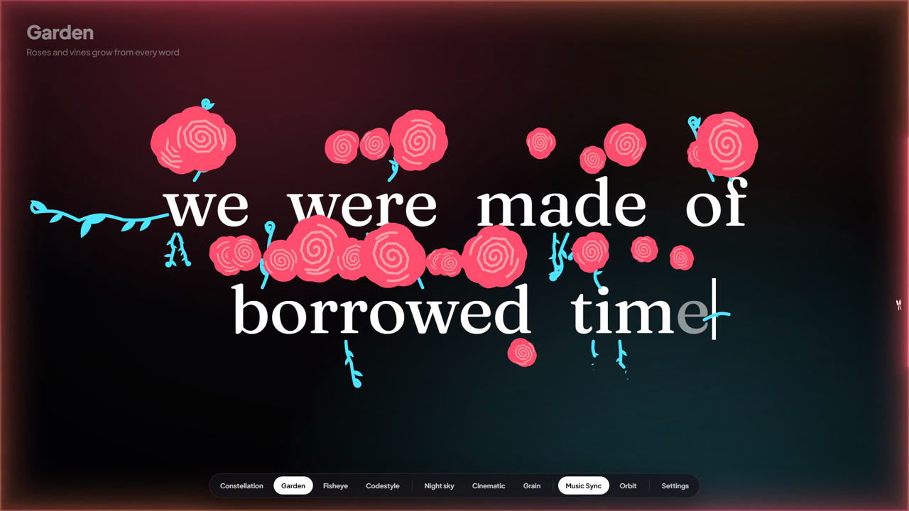

# Bountiful Lyrics

Immersive word-by-word lyrics and album-coloured edge glow for Spotify (Spicetify) and YouTube Music.



## Install on Spotify

You need Spotify desktop with [Spicetify](https://spicetify.app) already working.

**From Spicetify Marketplace**

Open Marketplace in Spotify, go to Extensions, search for "Bountiful Lyrics" and click Install.

**Manually, on Windows (PowerShell)**

```powershell
New-Item -ItemType Directory -Force "$env:APPDATA\spicetify\Extensions" | Out-Null
Invoke-WebRequest "https://raw.githubusercontent.com/Arpit-oo/bountiful-lyrics/main/release/bountiful-lyrics.js" -OutFile "$env:APPDATA\spicetify\Extensions\bountiful-lyrics.js"
spicetify config extensions bountiful-lyrics.js
spicetify apply
```

**Manually, on macOS or Linux**

```sh
mkdir -p ~/.config/spicetify/Extensions
curl -fsSL "https://raw.githubusercontent.com/Arpit-oo/bountiful-lyrics/main/release/bountiful-lyrics.js" -o ~/.config/spicetify/Extensions/bountiful-lyrics.js
spicetify config extensions bountiful-lyrics.js
spicetify apply
```

Spotify restarts. Open the lyrics with the star button in the top bar. If Spotify does not reopen, start it yourself.

To update, run the same commands again. To remove it:

```
spicetify config extensions bountiful-lyrics.js-
spicetify apply
```

If it disappears after Spotify updates itself, run `spicetify backup apply`.

## Develop

```
npm install
npm test
```

## Spotify plugin

Build and install your local copy:

```
npm run install:spicetify
```

Builds the extension, adds it to Spicetify and restarts Spotify. Open it with the star button in Spotify's top bar.

Three ways to view it, switchable from the bottom bar or Settings → Open in:

- **Inside Spotify**: fills the main view like a normal page. The sidebar and playbar stay usable; navigating away closes it.
- **Fullscreen**: takes over the screen. Press `F` to toggle, `Space` to play or pause, `Esc` to close.
- **Pop-out window**: a separate always-on-top window for another monitor. Drag anywhere to move it, drag an edge or corner to resize (applied when you let go), double-click for fullscreen. It remembers its size and place and keeps animating when Spotify is minimised.

Styles:

- **Constellation**: each phrase becomes a star pattern on a clean black screen, one star per word, in the album's colour.
- **Garden**: lines are typed in a serif while roses (album colour) and vines (its complement) grow out of every word.
- **Fisheye**: a rolling 3D drum of words with icons and accent chips.
- **Codestyle**: lyrics typed as code.

Backgrounds: Match style, Atmospheric gradient (Garden's default), Cinematic blur, Ambient album colours, Frosted album art, Film grain, Night sky or Black. Backdrops lift softly on the beat. The cover/star button in the bottom bar flips between album art and the style's own backdrop.

Edge glow: Music Sync (default) walks light around the screen edges on the beat, like a lit monitor bezel; Breathe, Drift and Still are calmer.

Settings (gear icon) has tabs for Lyrics, Look, Colour, Edge glow and More: style cards, ten fonts (including bubbly, retro script, hand-drawn and tall poster faces), star and word size for Constellation, Tilt for Fisheye and Codestyle, colour wheels for manual colours.

Lyrics come from Spotify first, then LRCLIB. When neither has timing, the plain text is shown.

After Spotify updates itself, run `spicetify backup apply`.

## Desktop companion (Windows)

```
npm run build -w @bountiful/companion
apps\companion\src-tauri	arget
eleaseountiful-companion.exe
```

A normal app window that shows the lyrics from Spotify: drag it to any monitor, resize it, F11 or double-click for fullscreen. The bar at the bottom controls Spotify (play, pause, skip, seek, volume) and the gear opens the same settings as the plugin. Keys: Space play/pause, N/P next/previous, arrows seek and volume, S settings.

With the companion running, the plugin's pop-out button opens this window (Spotify's own pop-out is limited to half a screen on one monitor). The tray icon can also draw the glow around your whole screen, choose displays and open idle mode. Closing the window quits the app unless the screen glow is on.

## YouTube Music extension

```
npm run build -w @bountiful/ytmusic
```

The build writes ready-to-load folders to the repo root:

- **Chrome, Brave, Edge**: open `chrome://extensions` (or `brave://extensions`, `edge://extensions`), turn on Developer mode, Load unpacked, pick `extension-chrome`.
- **Firefox (121+)**: open `about:debugging#/runtime/this-firefox`, Load Temporary Add-on, pick `extension-firefox/manifest.json`. Temporary add-ons last until Firefox restarts; a permanent install needs Mozilla signing.

On music.youtube.com press Alt+L (or the star button) to open it, Esc to go back. Inside: Q up next, S settings, 1-4 styles, F fullscreen, Space, arrows, M.

YouTube Music does not provide beat data, so the beat glow modes pulse at a calm tempo there.

## Publish to Spicetify Marketplace

Marketplace lists public GitHub repositories that have the `spicetify-extensions` topic and a valid `manifest.json` in the root. This repository already has the manifest, `docs/preview.png` and the built `release/bountiful-lyrics.js`.

To list it, add the topic once:

```
gh repo edit Arpit-oo/bountiful-lyrics --add-topic spicetify-extensions
```

Or use the gear next to About on the GitHub repository page. To remove it from Marketplace, remove the topic.

To ship a new version, rebuild the release file and push it to `main`:

```
npm run release:spicetify
git add release/bountiful-lyrics.js
git commit -m "Release plugin"
git push
```

## Layout

- `packages/core`: lyrics, timing, renderers, glow, settings UI
- `packages/protocol`: validated messages between the plugin and companion
- `apps/spicetify`, `apps/companion`, `apps/ytmusic`: the three targets
